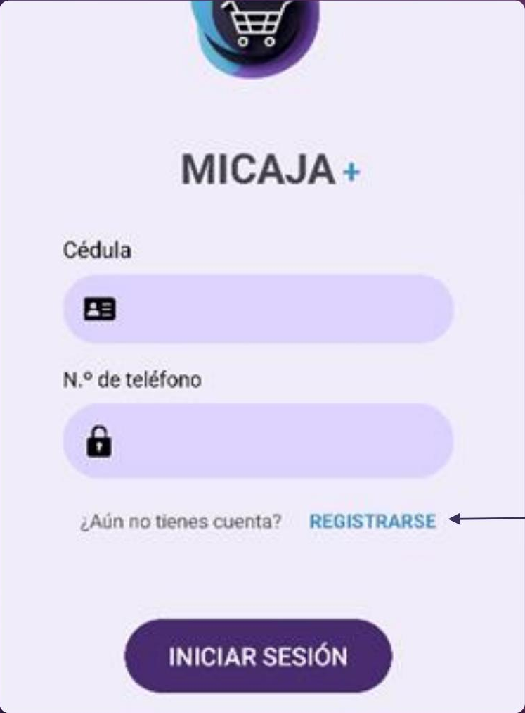
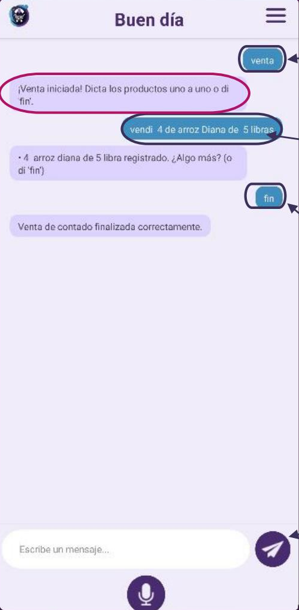
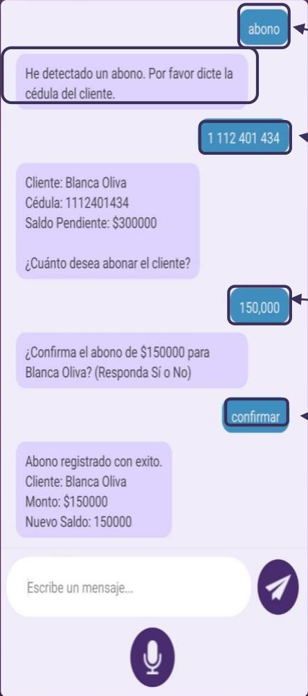
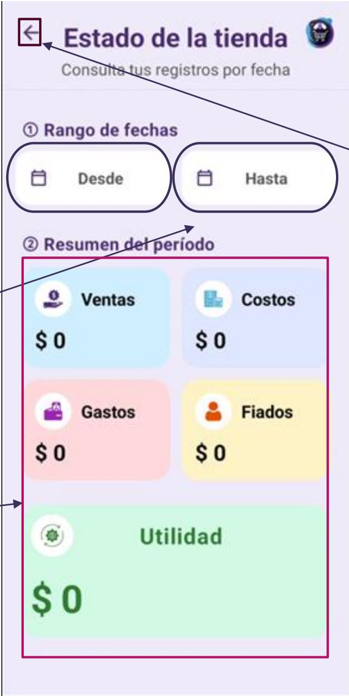

# Manual de usuario · MiCaja Plus (v2.0)

MiCaja Plus es un sistema de gestión para tiendas de barrio que permite registrar y controlar rápidamente las operaciones diarias del negocio: ventas, gastos, costos, créditos y clientes. Incorpora reconocimiento de **comandos de voz** para agilizar la atención y un **panel web** para consultar reportes desde el computador.

## Contenido

1. [Glosario](#glosario)
2. [Primeros pasos](#primeros-pasos)
3. [Operaciones en la app móvil](#operaciones-en-la-app-móvil)
4. [Ventanas principales](#ventanas-principales)
5. [Panel web](#panel-web)

## Glosario

| Término | Definición |
|---|---|
| Tendero | Persona que administra la tienda y usa el sistema. |
| Operación | Registro de una venta, gasto, crédito o costo. |
| Crédito (fiado) | Venta que el cliente paga después. |
| Abono | Pago parcial que el cliente hace a su deuda. |
| Monto | Cantidad de dinero de una transacción. |
| Comando de voz | Instrucción hablada que el sistema reconoce. |
| Base | Dinero en efectivo (monedas y billetes pequeños) con el que se abre la caja al iniciar el día. |
| Categoría | Agrupación de productos con características similares (uso, función o marca). |
| Campo | Área de la interfaz destinada a ingresar, mostrar o seleccionar un dato. |
| Menú desplegable | Elemento que muestra una lista de opciones oculta al inicio. |
| Dashboard | Panel web donde se muestran los reportes y estadísticas del negocio. |
| Sesión | Tiempo que el usuario permanece dentro del sistema. |

## Primeros pasos

Si es la primera vez que usas la aplicación, sigue estos pasos en orden:

1. [Registrarte](#1-registro-de-usuario)
2. [Iniciar sesión](#2-inicio-de-sesión)
3. [Abrir la tienda y registrar la base](#3-abrir-la-tienda)
4. [Agregar productos y clientes](#4-agregar-productos-y-clientes)

### 1. Registro de usuario

En la pantalla de inicio de sesión pulsa **REGISTRARSE** (texto azul) y completa:

1. **Nombre:** tu nombre o un alias.
2. **Cédula:** tu número de identificación.
3. **N.º de teléfono:** el celular con el que te registras. **Ten cuidado al escribirlo:** no se muestra mientras lo digitas porque será tu contraseña.
4. Pulsa **REGISTRARME** para guardar tu usuario.

### 2. Inicio de sesión

1. **Cédula:** la que usaste al registrarte (mínimo 6 y máximo 10 dígitos).
2. **N.º de teléfono:** el celular registrado (10 dígitos).
3. Pulsa **INICIAR SESIÓN**.

Si aún no tienes cuenta, usa **REGISTRARSE** para ir al formulario de registro.

### 3. Abrir la tienda

1. Escribe en el campo *"Escribe un mensaje..."* la frase **abrir tienda**, o pulsa una vez el botón del **micrófono** y dila en voz alta.
2. Pulsa el botón de **avión de papel** para enviar el mensaje.
3. El sistema responde *"Tienda abierta, ¿cuál es la base del día de hoy?"*. Indica el monto inicial por voz o escribiéndolo y envíalo. Ejemplo: `10000`.

### 4. Agregar productos y clientes

**Agregar un producto**

1. En la ventana de operaciones envía **agregar producto** para abrir el formulario.
2. Completa los campos:
   - **Nombre del Producto**
   - **Categoría:** elígela en la lista.
   - **Presentación:** escribe la cantidad junto a la unidad de medida (por ejemplo `350 ml`, no `350ml`).
   - **Cantidad:** número de unidades que tienes.
   - **Precio Compra ($):** precio unitario al que compraste.
   - **Precio Venta ($):** precio unitario al que lo vendes.
3. Pulsa **Guardar Producto** para almacenarlo en el inventario.

**Agregar un cliente**

1. Envía **nuevo cliente**.
2. Cuando el sistema lo pida, escribe o dicta la **cédula** del cliente.
3. Luego indica su **nombre y teléfono** en un solo mensaje. Ejemplo: `Juan Posada 3128024567`.

## Operaciones en la app móvil

Todas las operaciones se inician en el chat enviando una palabra clave. El sistema te guía con preguntas.

### Venta

1. Envía **venta**.
2. Indica cada producto vendido con el formato *cantidad / producto / presentación*. Ejemplo: `vendí 4 arroz Diana de 5 libras`.
3. Cuando termines de registrar los productos, envía **fin** para finalizar la venta.

### Costos (compras)

1. Envía **compra**.
2. Escribe el nombre del producto comprado (debe existir previamente en el inventario).
3. Indica la cantidad y la presentación. Ejemplo: `10 kilos`.
4. Indica el precio total de la compra. Ejemplo: `$30.000`.
5. Indica el nombre del proveedor y confirma la operación.

### Gastos

Un gasto es la salida voluntaria de dinero para adquirir bienes o servicios, o para satisfacer necesidades del negocio.

1. Envía **gasto**.
2. Escribe o dicta el valor y el motivo. Ejemplo: `gasté 5000 en salchipapa`.
3. Envía **fin** cuando hayas registrado todos los gastos.

### Créditos (fiados)

1. Envía **crédito**.
2. Indica la **cédula** del cliente al que le fiarás. El sistema muestra su nombre y saldo actual.
3. Indica el producto vendido a crédito (*nombre / presentación*). Debe estar registrado en el inventario.
4. Envía **fin** para terminar el crédito.

### Abonos

1. Envía **abono**.
2. Indica la **cédula** del cliente. El sistema muestra su saldo pendiente.
3. Indica el **monto** del abono.
4. Confirma la operación respondiendo **confirmar** (o *sí*).

### Cerrar la tienda

Al terminar la jornada, envía **cerrar tienda**. El sistema responde *"Tienda cerrada correctamente. ¡Buen descanso!"*.

## Ventanas principales

### Ventana de operaciones

Es donde se realizan la mayoría de las operaciones de la app.

- **Menú desplegable (☰):** opciones adicionales del sistema.
- **Campo de chat:** aquí escribes las operaciones.
- **Botón de enviar (avión de papel):** envía el mensaje al sistema.
- **Botón de micrófono:** pulsa para dictar tus operaciones y luego usa el botón de enviar.

### Menú desplegable

- **Cómo usar el chat:** muestra las palabras clave de cada operación.
- **Consultar Balance:** abre la consulta de balance.
- **Editar Cliente:** abre la edición de clientes.
- **Editar Producto:** abre la edición de productos.
- **Cerrar sesión (icono de salida):** termina tu sesión y vuelve al inicio de sesión.

### Ventana de ayuda ("Cómo usar el chat")

Muestra tarjetas moradas con los ejemplos de cada operación (abrir tienda, registrar base, venta, gasto, costo, cerrar tienda, crédito o abono, agregar producto). Al tocar una tarjeta verás la lista de palabras que puedes usar para ejecutar esa operación. Cierra la ventana con la **X**.

### Consultar balance

Muestra el resumen de tus operaciones en un rango de fechas: **Ventas, Costos, Gastos, Fiados y Utilidad**.

1. Pulsa **Desde** y elige la fecha de inicio.
2. Pulsa **Hasta** y elige la fecha final.
3. El resumen del período se actualiza con el rango elegido.

Usa la flecha de la esquina superior izquierda para volver.

### Editar producto

1. Escribe el nombre del producto en **Buscar por nombre...** y pulsa la lupa.
2. Modifica los campos: **Nombre del Producto, Presentación, Precio Venta ($) y Cantidad**.
3. Pulsa **Editar Producto** para guardar los cambios.

### Editar cliente

1. Escribe la **cédula** del cliente y pulsa la lupa. La **X** borra el campo.
2. Modifica los datos que necesites: **nombre, teléfono y valor del crédito**. La cédula no se puede editar.
3. Pulsa **Actualizar Datos** para guardar los cambios.

## Panel web

> Debes crear tu usuario primero desde la app móvil para poder usar el panel web.

### Inicio de sesión

1. **Cédula:** la registrada (6 a 10 dígitos).
2. **N.º de teléfono:** el celular registrado (10 dígitos).
3. Pulsa **INICIAR SESIÓN**.

### Dashboard

- **Menú desplegable (☰):** contiene los **Filtros** para consultar tus estadísticas.
- **Resumen:** ventas, costos, gastos, fiados y utilidad del rango de fechas elegido.
- **Historial:** transacciones realizadas durante el día.

### Consultar balance por fechas

1. **Fecha Inicial:** elige desde qué día consultar.
2. **Fecha Final:** elige hasta qué día consultar.
3. Pulsa **Buscar** para aplicar el rango.
4. **Quitar Filtros** deja las fechas en blanco.
